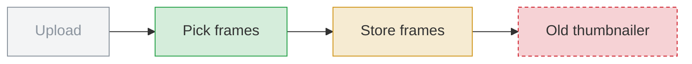
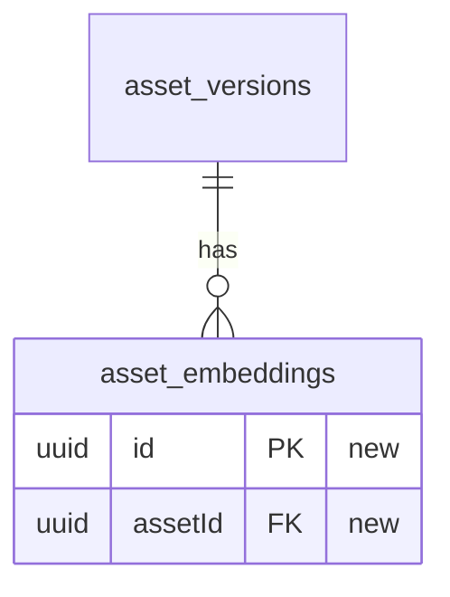

Write the PR description for the whole branch against its merge-base, and keep it up to date as the branch changes. Write it in the PR, not the chat. In the chat, reply with one line and the PR link.

Keep it concise, simple and jargon-free.

## Writing it

1. Commit and push any local changes, so the description matches the code on the PR.
2. Find the PR with `gh pr view --json number,url,body,headRefOid`. If there isn't one, open it with `gh pr create`, using the title of the change.
3. Write the body to a file in your scratch directory and run `gh pr edit <number> --body-file <file>`.

Put the description between these markers, so an update replaces only this part and keeps anything people add around it, such as screenshots:

```
<!-- siddy:pr-description:start -->
...
<!-- siddy:pr-description:end -->
```

- If the body has the markers, replace only what's between them.
- If it doesn't, replace a description you wrote earlier, or put the block above any text someone else wrote.
- Keep any attribution line at the end, outside the markers.

## Keeping it up to date

Whenever you push more commits to the branch, write the description again for the whole branch and replace the block. Do this without being asked, before you tell the user the push is done.

## How to present

- Reference changes to services, including new or changed services and their methods. Link them to GitHub at the PR's head commit, such as [UserService.create()](https://github.com/OWNER/REPO/blob/HEAD_SHA/src/user.ts#L42).
- Skip any sections that are not relevant. For example, a small UX change may just need an overview, whereas a new feature may need everything.
- `gh` can't upload screenshots or videos. Link them only if they already have a URL. Otherwise tell the user in the chat that they can drag them into the PR, outside the markers.
- Quote any Mermaid label that contains brackets, parentheses or punctuation, such as `a["Save (retry)"]`.

Use the format below. Lines in `<!-- -->` are instructions for you; don't copy them into the PR.

````
## Overview

<!-- An overview of the changes made and why they were made. -->

## Risks

<!--
Think about what could go wrong once this change goes into production.
Group related edits, with the highest blast radius first.
- 🔴 High: can cause a major break in production (data loss, auth, billing, outage, bad migration).
- 🟡 Medium: the product stays up, but a real user path is wrong.
- 🟢 Low: a small UI bug.
-->

| # | Level | Description |
|---|---|---|
| 1 | 🔴 | <!-- A description of the risk. --> |

## Pipelines

<!--
If the change touches a flow, draw one `flowchart LR` per pipeline under a `###` heading: main paths, then failures, then one-off scripts.
- Short plain step names. Keep the unchanged steps around the change.
- Mark each step :::new, :::changed, :::deleted or :::same, and copy the classDef lines as they are.
- Code names and numbers go in the Details list, not the diagram.
-->

### Video upload



<details><summary>Details</summary>

- **Pick frames**: <!-- Code names, files and numbers for this step. -->

</details>

## Data model

<!--
If the database schema changed, draw one `erDiagram`.
- Show every new, changed or deleted table, column, extension or enum, plus the tables they link to.
- Mark each new, changed or deleted column with a quoted comment.
-->



- 🟢 New: <!-- tables -->
- 🟡 Changed: <!-- tables -->
- 🔴 Deleted: <!-- tables -->

## New patterns

<!-- Compare the changes with the rest of the codebase. Are there new code or architecture patterns that we use in the change? -->

| # | New pattern |
|---|---|
| 1 | <!-- A description of the new pattern. --> |
````
